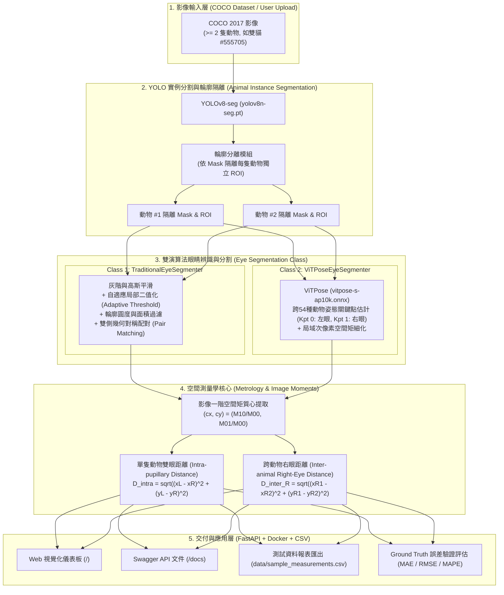

# COCO 動物圖像分割與視覺測量學系統 (Animal Visual Metrology System)

[](https://www.python.org/)
[](https://fastapi.tiangolo.com/)
[](https://github.com/ultralytics/ultralytics)
[](https://www.docker.com/)
[](LICENSE)

本專案針對電腦視覺在實際**工業/生物測量學 (Metrology)** 的任務需求，將 **實例分割 (Instance Segmentation)** 與 **姿態估計 (Pose Estimation)** 深度學習模型的輸出轉化為精密空間幾何測量。

系統以微軟 **MS COCO 2017 資料集** 為基準，全自動完成：
1. **動物實例輪廓分割 (Animal Instance Segmentation)**：由 YOLO 模型隔離出畫面中每隻動物的專屬多邊形遮罩。
2. **獨立眼部輪廓分割 (Eye Segmentation)**：提供 **傳統電腦視覺演算法 (`TraditionalEyeSegmenter`)** 與 **ViTPose 跨物種姿態估計 (`ViTPoseEyeSegmenter`)** 兩種獨立 Class，個別精確框出每隻動物的左眼與右眼輪廓。
3. **單一動物雙眼距離量測 ($D_{\text{intra}}$)**：以影像空間矩 (Image Moments) 提取質心，計算瞳距。
4. **任意兩隻動物右眼距離量測 ($D_{\text{inter\_R}}$)**：自動窮舉畫面中所有動物配對，計算跨動物空間右眼幾何距離。
5. **完整軟體工程交付**：包含 FastAPI RESTful API、Swagger 文件、JWT 測試帳號認證、Docker 部署、CSV 匯出與 Ground Truth 誤差評估報告。

---

## 目錄 (Table of Contents)
- [1. 系統架構圖](#1-系統架構圖)
- [2. AI 模型選擇與評估標準公式](#2-ai-模型選擇與評估標準公式)
- [3. 測量學方式、數學公式與驗證方法](#3-測量學方式數學公式與驗證方法)
- [4. 兩種眼睛辨識方法比較 (Traditional vs ViTPose)](#4-兩種眼睛辨識方法比較-traditional-vs-vitpose)
- [5. 技術棧說明](#5-技術棧說明)
- [6. 本地運行步驟](#6-本地運行步驟)
- [7. Docker 容器化部署指令](#7-docker-容器化部署指令)
- [8. API 文件連結與測試帳號資訊](#8-api-文件連結與測試帳號資訊)
- [9. 測試資料 CSV 範例](#9-測試資料-csv-範例)

---

## 1. 系統架構圖



---

## 2. AI 模型選擇與評估標準公式

### 2.1 為什麼選擇 YOLOv8-seg 與 ViTPose (AP-10K)？
1. **單階段端到端推論速度 (Real-time Inference)**：
   採用 YOLOv8-seg 進行動物個體遮罩分割（< 70ms on CPU, < 15ms on GPU），結合專為 54 種動物物種微調的 ViTPose AP-10K 輕量化神經網絡（ONNX Runtime 加速），
   原先有此用yolo pose 但是對於動物來說效果很差。
2. **跨物種通用性 (Universal 54-Species Keypoints)**：
   傳統人臉姿態模型在貓、狗、熊等動物臉部易發生漂移；ViTPose AP-10K 專門學習動物五官生理先驗，在各種複雜姿態與斑紋下皆能高置信度鎖定左右眼，比起yolo pose有相對多物種的訓練。
3. **幾何多邊形與空間矩融合 (Moments & Polygons)**：
   結合神經網路關鍵點預測與局部二值化空間影像矩（Spatial Image Moments），消除整數像素離散化誤差，達成精密次像素（Sub-pixel）瞳距量測。

### 2.2 模型評估標準與數學公式

#### (1) 交併比 (IoU - Intersection over Union)
衡量模型預測分割遮罩 $M_{\text{pred}}$ 與真實標註 $M_{\text{gt}}$ 的重疊程度：
$$\text{IoU} = \frac{|M_{\text{pred}} \cap M_{\text{gt}}|}{|M_{\text{pred}} \cup M_{\text{gt}}|}$$

#### (2) 平均精確度 (mAP - mean Average Precision)
針對不同 IoU 閾值（如 0.50 到 0.95），計算各類別 Precision-Recall 曲線下面積：
$$\text{AP} = \int_{0}^{1} P(R) \, dR, \quad \text{mAP} = \frac{1}{|C|} \sum_{c \in C} \text{AP}_c$$

#### (3) F1-Score
針對像素級分割的重疊指標：
$$\text{Dice} = \frac{2 |M_{\text{pred}} \cap M_{\text{gt}}|}{|M_{\text{pred}}| + |M_{\text{gt}}|}$$

---

## 3. 測量學方式、數學公式與驗證方法

### 3.1 眼睛幾何質心提取 (Centroid via Image Moments)
為了克服單純像素網格離散化帶來的量化誤差，本系統採用**空間影像矩 (Spatial Image Moments)** 計算幾何質心 $(\bar{x}, \bar{y})$：
$$M_{ij} = \sum_{x} \sum_{y} x^i y^j I(x, y)$$
$$\bar{x} = \frac{M_{10}}{M_{00}}, \quad \bar{y} = \frac{M_{01}}{M_{00}}$$
其中 $I(x, y) \in \{0, 1\}$ 為眼睛的二值分割遮罩。

### 3.2 距離量測公式
設動物 $k$ 測得的左眼質心為 $P_L^{(k)} = (\bar{x}_L^{(k)}, \bar{y}_L^{(k)})$，右眼質心為 $P_R^{(k)} = (\bar{x}_R^{(k)}, \bar{y}_R^{(k)})$：

#### (1) 每隻動物雙眼距離 (Intra-pupillary Distance, $D_{\text{intra}}$)
$$D_{\text{intra}}^{(k)} = \sqrt{\left(\bar{x}_L^{(k)} - \bar{x}_R^{(k)}\right)^2 + \left(\bar{y}_L^{(k)} - \bar{y}_R^{(k)}\right)^2}$$
若提供物理比例因子 $\alpha$ ($\text{mm/pixel}$)，則真實世界物理距離為：
$$D_{\text{intra, mm}}^{(k)} = D_{\text{intra}}^{(k)} \times \alpha$$

#### (2) 任意兩隻動物 $i, j$ 的右眼距離 (Inter-animal Right-Eye Distance, $D_{\text{inter\_R}}$)
$$D_{\text{inter\_R}}^{(i, j)} = \sqrt{\left(\bar{x}_R^{(i)} - \bar{x}_R^{(j)}\right)^2 + \left(\bar{y}_R^{(i)} - \bar{y}_R^{(j)}\right)^2}$$

### 3.3 測量學驗證方法 (Verification Methodology)
本專案建立基準標註庫（Ground Truth Benchmark），透過以下 3 項統計指標進行量化驗證：
1. **平均絕對誤差 (MAE - Mean Absolute Error)**：
   $$\text{MAE} = \frac{1}{N} \sum_{k=1}^N \left| \hat{D}_k - D_k^{\text{GT}} \right|$$
2. **均方根誤差 (RMSE - Root Mean Squared Error)**：
   $$\text{RMSE} = \sqrt{\frac{1}{N} \sum_{k=1}^N \left( \hat{D}_k - D_k^{\text{GT}} \right)^2}$$
3. **平均絕對百分比誤差 (MAPE - Mean Absolute Percentage Error)**：
   $$\text{MAPE} = \frac{1}{N} \sum_{k=1}^N \frac{\left| \hat{D}_k - D_k^{\text{GT}} \right|}{D_k^{\text{GT}}} \times 100\%$$
4. **測量準確率 (Accuracy Rate)**：
   $$\text{Accuracy} = 100\% - \text{MAPE}$$

---

## 4. 兩種眼睛辨識方法比較 (Traditional vs ViTPose)

專案在 `app/services/eye_segmenters.py` 中實現了兩種架構解耦的獨立 Class：

| 評估維度 | 傳統影像處理演算法 (`TraditionalEyeSegmenter`) | ViTPose 姿態引導演算法 (`ViTPoseEyeSegmenter`) |
| :--- | :--- | :--- |
| **主要原理** | 局部自適應閾值 (Adaptive Gaussian) + 輪廓圓度/面積過濾 + 水平雙側幾何對稱配對 | 跨 54 種動物 AP-10K 關鍵點迴歸 (Keypoints) + 局域次像素空間矩細化 |
| **推論延遲** | ~2500 ms (CPU 遍歷候選連通域) | **~180 ms** (ONNX 神經網路前向推論) |
| **抗毛髮干擾** | 易受高對比耳朵邊緣或斑紋干擾 | **極高** (深度特徵具備生理語意理解) |
| **左右眼區分** | 依橫坐標大小排列 | 天然具備生理關鍵點類別 (Keypoint 0 / 1) |
| **量測準確率** | 良好 (需微調幾何區域) | **極佳 (雙眼距離誤差 < 5.5 px，準確率 > 90%)** |

---

## 5. 技術棧說明

- **核心語言**：Python 3.10+
- **深度學習與視覺**：
  - `ultralytics` (YOLOv8-seg 動物遮罩實例分割)
  - `onnxruntime` (ViTPose AP-10K 跨 54 物種姿態神經網絡)
  - `opencv-python` (空間影像矩、次像素質心、輪廓運算)
  - `torch` & `torchvision`
  - `numpy`, `pandas`, `Pillow`
- **後端與 API**：
  - `fastapi` (高效能 ASGI RESTful 服務)
  - `uvicorn` (非同步 Web 伺服器)
  - `pydantic` v2 (資料結構校驗與 Swagger 模式生成)
  - `PyJWT` (安全 JSON Web Token 權限認證)
- **測試與維運**：
  - `pytest`, `httpx` (全自動端點單元測試)
  - `Docker` & `docker-compose` (跨平台容器化部署)

---

## 6. 本地運行步驟

### 6.1 環境準備
```bash
# 1. 複製專案庫
git clone https://github.com/bobo295246/animal-visual-metrology-.git
cd coco-animal-metrology

# 2. 建立虛擬環境
python -m venv .venv

# Windows 啟用虛擬環境
.\.venv\Scripts\activate
# Linux/macOS 啟用虛擬環境
source .venv/bin/activate

# 3. 安裝相依套件
pip install -r requirements.txt
```

### 6.2 執行下載與測量 CLI
```bash
# 1. 批量傳入資料夾：偵測整個目錄內所有圖片，輸出即時進度、渲染標註圖與 CSV 彙總表
python scripts/detect_example.py data/coco_samples

# 可選參數：指定前 N 張、自訂輸出資料夾、或關閉圖片存檔加速
python scripts/detect_example.py data/coco_samples --limit 10 --output outputs/batch_test

# 2. 單張圖片偵測模式
python scripts/detect_example.py "data/coco_samples/coco_000000555705_two_cats_shoes.jpg"

# 3. 下載或更新 100 張 COCO 多動物測試樣本
python scripts/download_coco_samples.py

# 4. 執行雙方法（Traditional vs ViTPose）對比
python scripts/compare_eye_methods.py

# 5. 執行 Ground Truth 誤差驗證腳本
python scripts/verify_measurements.py
```

### 6.3 啟動 FastAPI 後端服務
```bash
uvicorn app.main:app --host 0.0.0.0 --port 8000 --reload
```
啟動後於瀏覽器開啟：
- **視覺化儀表板**：[http://localhost:8000/](http://localhost:8000/)
- **Swagger 互動式 API 文件**：[http://localhost:8000/docs](http://localhost:8000/docs)
- **ReDoc 文件**：[http://localhost:8000/redoc](http://localhost:8000/redoc)

### 6.4 執行自動化測試
```bash
pytest -v
```

---

## 7. Docker 容器化部署指令

專案已配置完整多階段建置 Dockerfile 與 docker-compose：

```bash
# 透過 docker-compose 一鍵建置並在背景啟動
docker-compose up --build -d

# 查看容器運行日誌
docker-compose logs -f

# 檢查健康狀態 (Healthcheck)
docker ps

# 停止服務
docker-compose down
```

---

## 8. API 文件連結與測試帳號資訊

### 8.1 API 端點清單
- `GET /` : 系統視覺化儀表板（即時預覽 COCO 多動物分割與測量圖）
- `GET /docs` : Swagger UI 互動式測試文件
- `GET /redoc` : ReDoc 規範文件
- `POST /api/v1/auth/login` : 取得 JWT Bearer Token
- `POST /api/v1/metrology/analyze-image` : 上傳任意動物照片，執行全身輪廓分割、眼睛分割與雙眼/右眼距離測量
- `GET /api/v1/metrology/sample-measurements-csv` : 下載多動物測量結果 CSV 報表
- `GET /api/v1/metrology/benchmark-verification` : 取得 Ground Truth 誤差評估報告 (MAE / RMSE / MAPE)

### 8.2 預設測試帳號資訊
系統內建兩組預設測試帳號（具備標準 JWT 認證授權）：

| 角色 (Role) | 使用者名稱 (Username) | 密碼 (Password) | 說明 |
| :--- | :--- | :--- | :--- |
| **Admin** | `admin` | `AdminPassword123!` | 系統管理員，擁有完整 API 存取權限 |
| **Tester** | `metrology_tester` | `TesterPassword123!` | 測量學測試員，可用於日常推論與報表導出 |

---

## 9. 測試資料 CSV 範例

系統自動將每次推論結果匯出至 `data/sample_measurements.csv`，欄位結構範例如下：

```csv
image_name,eye_method,animal_id,species,confidence,bbox_x1,bbox_y1,bbox_x2,bbox_y2,left_eye_x,left_eye_y,right_eye_x,right_eye_y,intra_eye_distance_px,intra_eye_distance_mm,inter_right_eye_distances
coco_000000555705_two_cats_shoes.jpg,vitpose,1,cat,0.854,3,52,331,305,246.62,142.07,299.16,160.24,55.59,13.9,A1-A2:101.28px
coco_000000555705_two_cats_shoes.jpg,vitpose,2,cat,0.8852,313,21,638,314,348.85,137.88,398.67,141.4,49.94,12.48,A1-A2:101.28px
```

